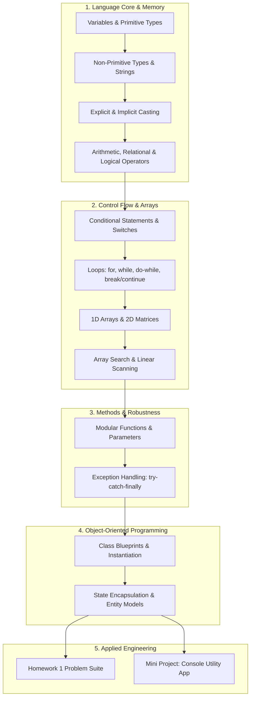

# ☕ Java Programming Masterclass — Fundamentals, OOP & Problem Solving

<div align="center">


<br/>

[](https://www.oracle.com/java/)
[]()
[]()
[](LICENSE)

<br/>

**A rigorous, structured codebase covering Core Java, Object-Oriented Programming (OOP), Data Structures, and Algorithmic Homework sets.**  
*From primitive memory casting and multi-dimensional arrays to custom class blueprints, encapsulation, exception handling, and interactive console projects.*

[📚 Curriculum Matrix](#-curriculum-matrix) • [🏛️ OOP Architecture](#️-object-oriented-programming-oops) • [📝 Academic Homework Sets](#-academic-homework-series-homework-1) • [⚡ Quick Start](#-quick-start)

---

</div>

## 📖 Overview

This repository represents a structured, code-first compendium of Java software development. It tracks the journey from language syntax, memory management, and control flow through to advanced object-oriented paradigms, modular method architecture, error handling, and algorithmic problem-solving.

---

## 📚 Curriculum Matrix



### Complete Topic Catalog

| Category | Source File | Key Concepts Demonstrated |
|:---|:---|:---|
| **Data Types & Memory** | [`variable.java`](variable.java), [`types.java`](types.java), [`non_primitive_types.java`](non_primitive_types.java) | Primitive declarations (`int`, `double`, `boolean`), reference objects |
| **Type Casting** | [`casting.java`](casting.java) | Widening vs. narrowing casting, truncation, ASCII conversion |
| **Operators & Math** | [`operators.java`](operators.java), [`pre_and_post_increment.java`](pre_and_post_increment.java), [`maths.java`](maths.java) | Math class methods (`sqrt`, `pow`, `abs`), prefix vs. postfix unary increments |
| **Logic & Conditionals** | [`comparison.java`](comparison.java), [`logical_operators.java`](logical_operators.java), [`conditionals_statements.java`](conditionals_statements.java), [`switch_operator.java`](switch_operator.java) | Boolean expressions, relational gates, multi-way branch selection |
| **String Manipulation** | [`strings.java`](strings.java), [`strings2.java`](strings2.java), [`sub_string.java`](sub_string.java) | Immutability, `length()`, `charAt()`, `substring()`, string pooling |
| **Loops & Iteration** | [`for_loops.java`](for_loops.java), [`while_loop.java`](while_loop.java), [`do_while_loop.java`](do_while_loop.java), [`break_and_continue.java`](break_and_continue.java) | Loop invariants, boundary termination, skip and break controls |
| **Array Engineering** | [`array.java`](array.java), [`arrays_2d.java`](arrays_2d.java), [`existing_data_find_in_array.java`](existing_data_find_in_array.java) | Memory allocation, index traversal, 2D matrix grids, search scanning |
| **Methods & Modularity** | [`methods.java`](methods.java), [`another_method_or_function.java`](another_method_or_function.java) | Method signatures, return values, formal arguments, static context |
| **Exception Handling** | [`exception_handling.java`](exception_handling.java) | Defensive programming with `try`, `catch`, runtime exception trapping |

---

## 🏛️ Object-Oriented Programming (OOPs)

Located in [`OOPs in Java/`](OOPs%20in%20Java):

- **Entity Modeling (`Student.java`):** Real-world object modeling with private instance fields, constructor initializers, and accessor methods.
- **Driver Programs (`Demo.java`, `Demo2.java`):** Demonstrating dynamic object instantiation, heap memory allocation, and method invocation.

---

## 📝 Academic Homework Series (Homework 1)

Located in [`Homework 1/`](Homework%201), providing solutions to classic algorithmic and computational problems:

| Program | Source File | Problem Statement & Solution |
|:---|:---|:---|
| **Simple Calculator** | [`SimpleCalculator.java`](Homework%201/SimpleCalculator.java) | Interactive arithmetic evaluator (+, -, *, /) using Scanner input |
| **Max & Min of Three** | [`MaxMinThreeNumbers.java`](Homework%201/MaxMinThreeNumbers.java) | Optimal conditional branching to isolate mathematical extrema |
| **Leap Year Checker** | [`LeapYear.java`](Homework%201/LeapYear.java) | Gregorian leap year logic ($(\text{year} \pmod{4} == 0 \land \text{year} \pmod{100} \ne 0) \lor \text{year} \pmod{400} == 0$) |
| **Geometry: Circle Area** | [`CircleArea.java`](Homework%201/CircleArea.java), [`CircleAreaMath.java`](Homework%201/CircleAreaMath.java) | Precision geometric calculation using radius and $\pi \times r^2$ |
| **Number Parity** | [`EvenOdd.java`](Homework%201/EvenOdd.java), [`PositiveNegative.java`](Homework%201/PositiveNegative.java) | Sign bit and bitwise/modulus parity evaluation |
| **Powers of Two** | [`PowersOfTwo.java`](Homework%201/PowersOfTwo.java) | Exponential progression and bit-shift power sequences |
| **Random Numbers** | [`RandomNumbers.java`](Homework%201/RandomNumbers.java) | Pseudorandom distribution generation within bounded ranges |
| **Array Input & Filtering** | [`ArrayInputPrint.java`](Homework%201/ArrayInputPrint.java), [`ArrayEvenNumbers.java`](Homework%201/ArrayEvenNumbers.java) | Dynamic user array populating and selective even-element filtering |

---

## ⚡ Quick Start & Compilation

Compile and run any Java file directly using the Java Development Kit (JDK):

### 1. Clone the repository
```bash
git clone https://github.com/nahidzaman1996271-sketch/Java.git
cd Java
```

### 2. Compile and Execute
```bash
# Example: Compile and run 2D Array matrix lesson
javac arrays_2d.java
java arrays_2d

# Example: Compile and run Homework Calculator
cd "Homework 1"
javac SimpleCalculator.java
java SimpleCalculator
```

---

## 📄 License

This repository is maintained for educational reference under the [MIT License](LICENSE).

---

<div align="center">
  <sub>Maintained by <a href="https://github.com/nahidzaman1996271-sketch">Nahid Zaman</a></sub>
</div>
